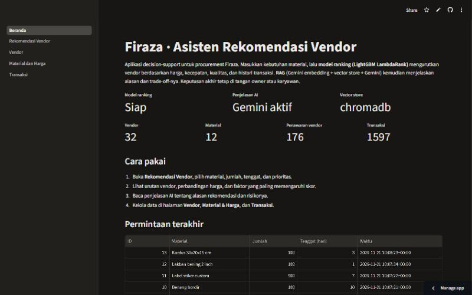
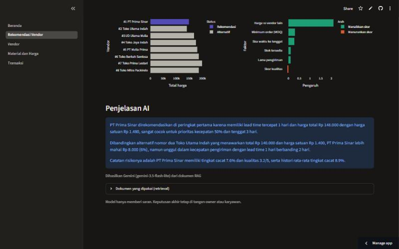
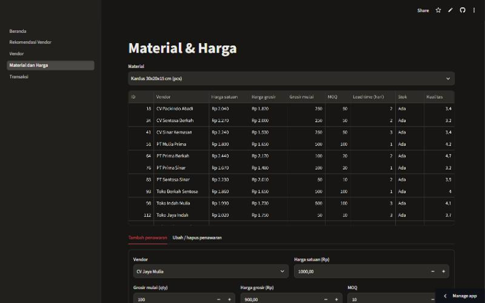
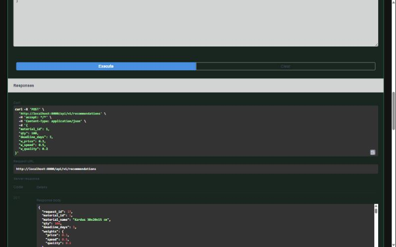
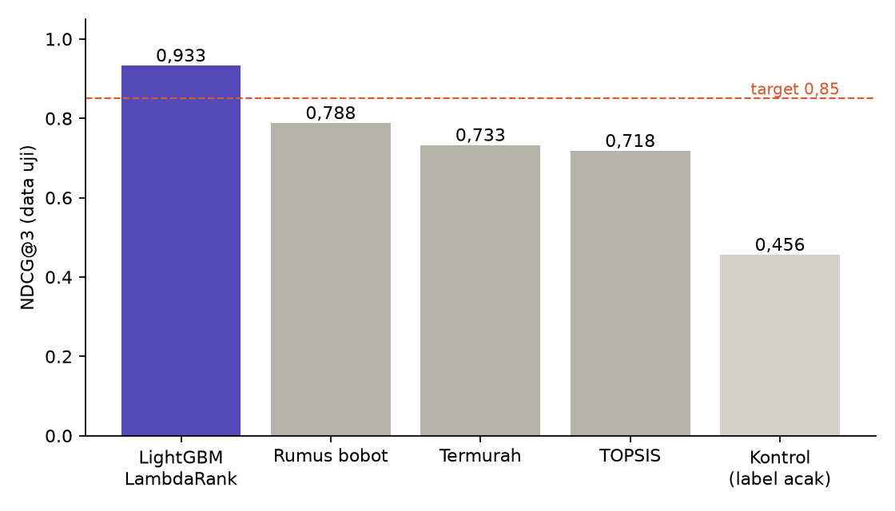

# Project Brief — Firaza Vendor Recommendation & Procurement Assistant

> Catatan penulis: template resmi Project Brief belum dibuka untuk akun ini (akses ditolak). Dokumen ini disusun mengikuti rubrik Project Brief; isinya dapat dipindahkan per bagian ke template saat tersedia.

## Identitas
- **ID Tim:** DB15-I036 (capstone individu)
- **Judul:** Firaza - Vendor Recommendation & Procurement Assistant: Sistem Rekomendasi Vendor Berbasis Model Ranking dan Retrieval-Augmented Generation (RAG)
- **Tema / Use case:** UMKM Firaza (CP-02) - Use Case 3: Vendor Recommendation & Procurement Assistant
- **Anggota:** b26b15a027 - Abid Dayyan - Generative AI - Aktif

## Tautan
| Item | Tautan |
|---|---|
| Aplikasi live (Streamlit) | https://firaza-vendor.streamlit.app |
| Repositori GitHub (MIT) | https://github.com/abidayn/Firaza |
| Dokumentasi API (Swagger) | dijalankan lokal di `http://localhost:8000/docs` (perintah di README); tangkapan layar di bagian Screenshot |
| Video demo fitur AI | https://github.com/abidayn/Firaza/blob/main/submission/videos/demo_fitur_ai.mp4 |
| Video presentasi 10 menit | **[ISI]** |
| Slide presentasi | https://github.com/abidayn/Firaza/blob/main/submission/slides/firaza_pitch.pptx |

## Ringkasan eksekutif
Firaza menjual hampers dan personalized gifts, dengan sekitar 99% penjualan online. Pemilihan vendor material (kardus, pita, packaging, bahan bordir/printing) masih dilakukan owner secara manual memakai spreadsheet dan ingatan. Padahal vendor termurah belum tentu terbaik jika lambat, berkualitas rendah, atau sering terlambat. Proyek ini membangun aplikasi web decision-support yang: (1) menyimpan data vendor, harga, lead time, kualitas, dan histori transaksi; (2) mengurutkan vendor untuk setiap kebutuhan procurement dengan **model ranking LightGBM LambdaRank yang dilatih sendiri**; dan (3) menjelaskan alasan serta trade-off rekomendasi dengan **RAG** (embedding Gemini, vector store ChromaDB, generation Gemini). Keputusan akhir tetap di tangan owner. Pada data uji, model mencapai **NDCG@3 0,933** (target minimal 0,85), jauh di atas baseline rumus bobot (0,788). RAG mencapai **Recall@3 1,0** dan **faithfulness 1,0**.

## Latar belakang dan masalah (5W+1H)
- **What:** pemilihan vendor material dilakukan manual tanpa perbandingan multi-atribut yang konsisten.
- **Why:** harga bukan satu-satunya faktor; keterlambatan atau cacat menghambat fulfillment pesanan.
- **Who:** owner dan karyawan Firaza yang menangani procurement.
- **Where:** operasional procurement Firaza; solusi diakses lewat web.
- **When:** setiap kebutuhan belanja material, terutama saat pesanan naik atau mendesak.
- **How:** model ranking + penjelasan RAG dalam aplikasi web.

## Fitur yang dibangun
1. **Rekomendasi vendor:** input material, jumlah, tenggat, prioritas (harga, kecepatan, kualitas) → urutan vendor dengan skor, harga total, lead time, kualitas, ketepatan waktu, dan penanda (melewati tenggat, di bawah MOQ, stok kosong).
2. **Penjelasan faktor model:** grafik kontribusi fitur (LightGBM `pred_contrib`) untuk vendor teratas.
3. **Penjelasan AI (RAG):** teks Bahasa Indonesia tentang alasan, trade-off, dan risiko, dengan daftar dokumen sumber. Angka diverifikasi otomatis; jika gagal atau Gemini tidak tersedia, muncul penjelasan template.
4. **Manajemen data:** CRUD vendor, material dan penawaran harga (harga satuan, harga grosir, MOQ, lead time, stok, kualitas), dan histori transaksi.
5. **REST API inferensi:** `/api/v1/recommendations` dan `/explanation`, plus CRUD, dengan dokumentasi Swagger.

## Arsitektur dan tech stack
Streamlit (UI) dan FastAPI (REST API) memanggil lapisan layanan yang sama. Data di PostgreSQL (Neon) atau SQLite (lokal). Model LightGBM dimuat sekali di server. RAG memakai embedding Gemini (`gemini-embedding-2`), vector store ChromaDB, dan generation Gemini (`gemini-3.5-flash-lite`, cadangan `gemini-3.8-flash`). API key hanya di environment variable / secrets. Detail: `docs/ARCHITECTURE.md`.

| Tools | Fungsi |
|---|---|
| Python, pandas, NumPy, Faker | pembuatan data sintetis, preprocessing |
| scikit-learn, SciPy | metrik dan evaluasi |
| LightGBM (LGBMRanker, lambdarank) | model ranking yang dilatih sendiri |
| Gemini API (embedding + generation) | RAG |
| ChromaDB | vector database |
| FastAPI, Pydantic, SQLAlchemy, pg8000 | REST API, validasi, ORM, driver Postgres |
| Streamlit, Plotly | antarmuka dan grafik |
| Neon Postgres, Streamlit Community Cloud | database dan hosting |
| pytest, pip-licenses | 14 tes otomatis, audit lisensi (SBOM) |

## Data dan preprocessing
Firaza tidak menyediakan data, jadi dibuat data sintetis yang dapat direproduksi (seed 42): 32 vendor, 12 material, 176 penawaran, 1.597 transaksi selama 18 bulan. Masalah data disengaja lalu dibersihkan: 15 duplikat, 7 waktu kirim mustahil (> 30 hari), dan 31 nilai cacat hilang (diisi median vendor). Setiap vendor memiliki "kebenaran tersembunyi" (keandalan dan kualitas asli) yang hanya dipakai untuk membuat label, sehingga model harus menyimpulkannya dari histori yang berisik. Dari 3.000 permintaan simulasi terbentuk 44.253 baris (permintaan × vendor) dengan 17 fitur dan label relevansi 0–4, dibagi per permintaan 70/15/15. Detail: `docs/DATA_CARD.md`.

## Model dan evaluasi
LightGBM `LGBMRanker` (objective `lambdarank`), early stopping (63 pohon). Hasil pada 450 permintaan uji:

| Metode | NDCG@1 | NDCG@3 | NDCG@5 | Kendall τ |
|---|---|---|---|---|
| **LightGBM LambdaRank** | **0,959** | **0,933** | **0,941** | **0,743** |
| Baseline termurah | 0,723 | 0,733 | 0,756 | 0,425 |
| Baseline rumus bobot | 0,813 | 0,788 | 0,810 | 0,524 |
| Baseline TOPSIS | 0,734 | 0,718 | 0,748 | 0,438 |
| Kontrol label acak | 0,437 | 0,456 | 0,498 | −0,013 |

Model mengungguli semua baseline. Kontrol label acak turun ke tingkat kebetulan, membuktikan skor berasal dari pola nyata. Detail: `docs/MODEL_CARD.md`, `ml/reports/metrics.md`.

## RAG dan evaluasinya
Basis pengetahuan berisi 70 dokumen: profil dan ringkasan kinerja tiap vendor (dibangun dari database), plus 6 catatan kebijakan procurement (asumsi ilustratif). Retrieval mengambil dokumen vendor teratas (filter metadata) dan 2 kebijakan paling relevan (pencarian semantik). Hasil: **Recall@3 = 1,0** (12 pertanyaan uji) dan **faithfulness = 1,0** (semua angka di 18 jawaban LLM ada di konteks). 2 dari 20 permintaan terkena overload Gemini dan otomatis memakai penjelasan template.

## Pemenuhan checklist learning path Generative AI (individu)
| Ketentuan | Bukti |
|---|---|
| Model AI disesuaikan dengan data, dilatih sendiri (bukan model siap pakai/AutoML) | `ml/train_ranker.py`, `backend/artifacts/ranker.txt` |
| Preprocessing sebelum model | `backend/app/core/features.py` (`clean_transactions`), grafik sebelum/sesudah |
| Sitasi dataset, library, model | README (References), `docs/SBOM.md`, `docs/DATA_CARD.md` |
| Fitur pertama bukan panggilan langsung API LLM | fitur pertama = model ranking; LLM hanya menjelaskan |
| Side Quest RAG: generation (Gemini), embedding (Gemini), vector DB (ChromaDB), terintegrasi ke aplikasi | `backend/app/rag/`, halaman Rekomendasi Vendor |
| Antarmuka inferensi (Streamlit minimum) | `frontend/` |
| Data persisten di database, live URL | Neon Postgres + Streamlit Cloud |
| API key aman | environment variable / secrets, tidak ada di repo (sudah dipindai) |
| Lisensi | MIT; dependensi permisif; 3 dependensi tidak langsung MPL didokumentasikan di `docs/LICENSE_NOTES.md` |

## Perubahan dari Project Plan
- Embedding memakai **Gemini embedding API**, bukan multilingual-e5 lokal, karena `torch` melebihi batas memori hosting gratis. Ini diizinkan playbook ("embedding via layanan API").
- **Satu repositori** dengan folder `backend/` dan `frontend/`, dan UI Streamlit memanggil lapisan layanan secara langsung (monolith diizinkan untuk capstone individu). REST API FastAPI tetap tersedia untuk inferensi.
- Tanpa Docker dan tanpa login (prototipe).
- Jadwal pengerjaan dipadatkan ke 21–22 November 2026.

## Cara menggunakan
Lihat `docs/USER_GUIDE.md` dan video demo. Singkatnya: buka Rekomendasi Vendor, isi kebutuhan, klik **Cari rekomendasi**, lalu baca urutan, grafik, dan penjelasan AI.

## Keterbatasan dan pengembangan lanjut
- Data sintetis: metrik membuktikan pipeline bekerja, bukan akurasi pada keputusan nyata Firaza.
- Belum ada login dan belum ada umpan balik dari pilihan owner untuk melatih ulang model.
- Kasus tepi: jika tidak ada vendor yang bisa memenuhi tenggat (misalnya kotak hampers premium dalam 1 hari), urutan lebih dipengaruhi harga sehingga vendor dengan ketepatan waktu rendah bisa berada di atas. Aplikasi tetap menandai semua vendor 'melewati tenggat' agar pengguna sadar risikonya.
- Langkah berikutnya: memakai data dan keputusan asli owner, menambah fitur tren harga, dan integrasi dengan pencatatan stok (Use Case 1).

## Screenshot

## Pengujian end-to-end
Sepuluh skenario diuji terhadap database produksi (Neon) dengan kode yang sama dengan aplikasi live, termasuk panggilan Gemini asli: semua lulus (urutan benar, penanda tenggat benar, penjelasan dari LLM). Tiga kasus error (material tidak ada, semua bobot nol, menghapus vendor yang masih dipakai) ditolak dengan pesan yang jelas. Detail: `docs/E2E_TEST.md`.
