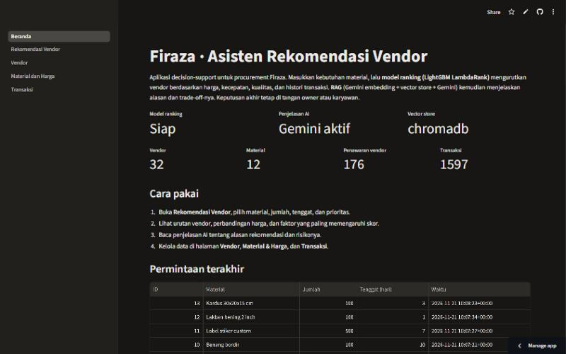
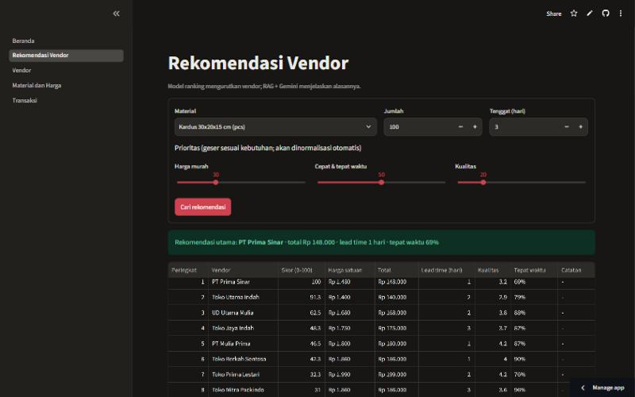
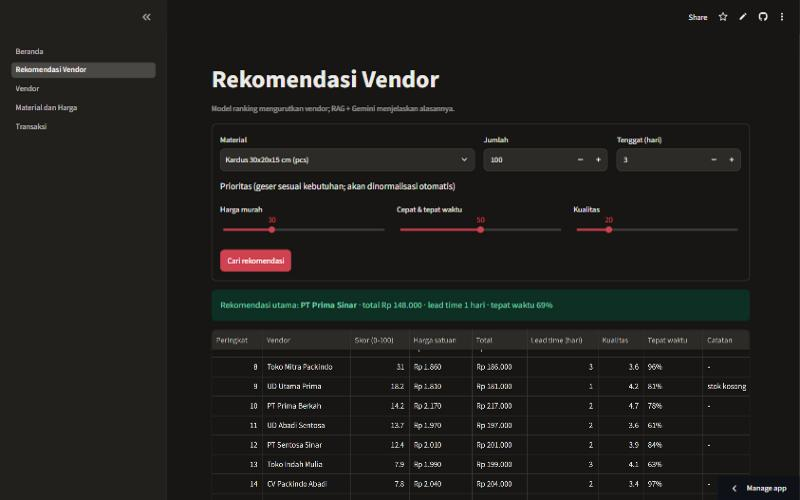
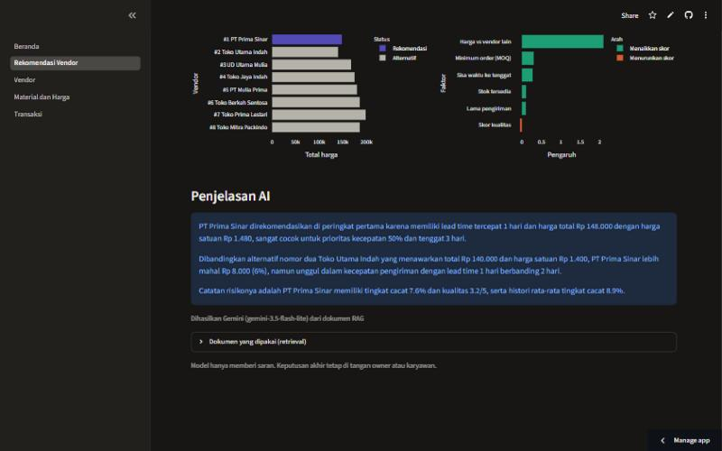
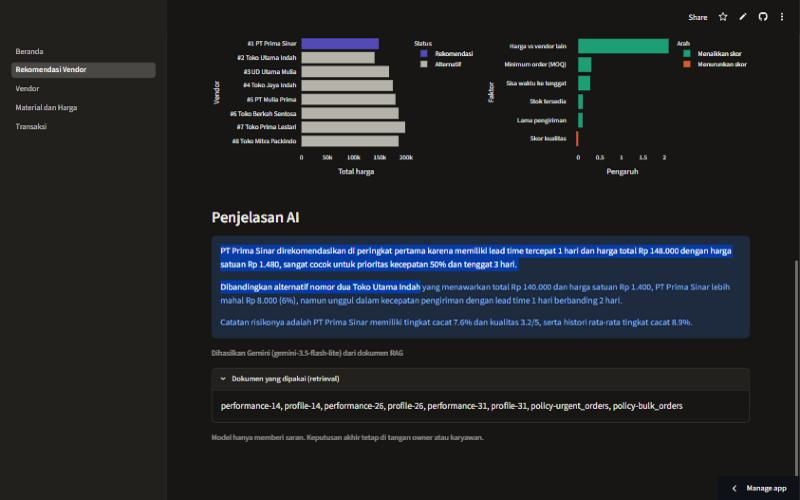
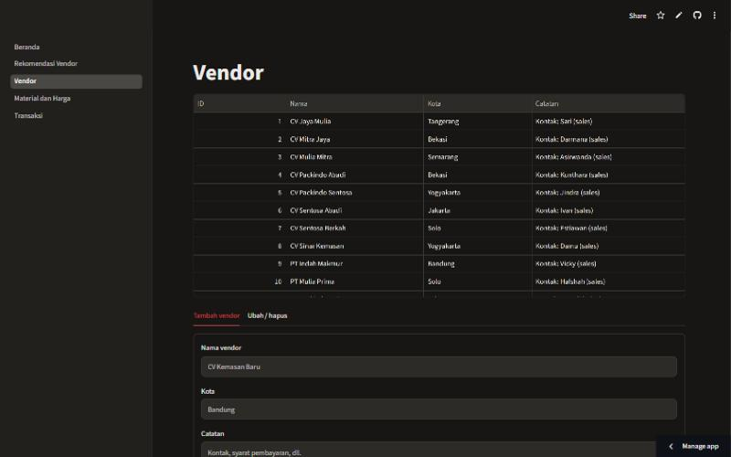
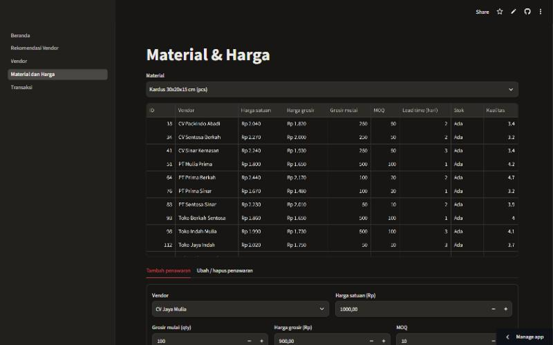
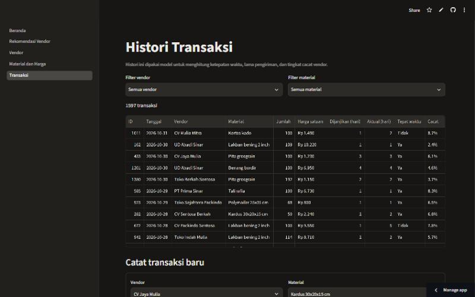
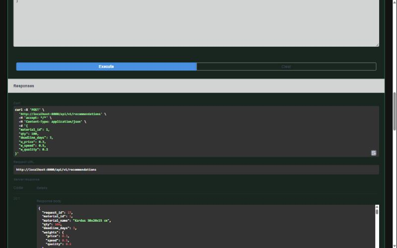

# Panduan Penggunaan Produk — Firaza Vendor Recommendation & Procurement Assistant

**Tim:** DB15-I036 (individu) · **Penyusun:** Abid Dayyan · **Aplikasi:** https://firaza-vendor.streamlit.app · **Kode:** https://github.com/abidayn/Firaza

## 1. Tentang aplikasi
Aplikasi ini membantu owner dan karyawan Firaza memilih **vendor material** (kardus, pita, packaging, bahan bordir/printing) secara konsisten. Anda memasukkan kebutuhan pembelian, lalu aplikasi:

1. **mengurutkan vendor** dengan model ranking (LightGBM LambdaRank) berdasarkan harga, lead time, kualitas, ketepatan waktu, tingkat cacat, MOQ, dan stok;
2. **menjelaskan alasannya** dalam Bahasa Indonesia dengan RAG (Gemini + dokumen vendor yang diambil dari vector store).

Aplikasi hanya memberi **saran**. Keputusan akhir tetap di tangan owner atau karyawan.

**Catatan:** seluruh data di prototipe ini adalah data sintetis (bukan data asli Firaza).

## 2. Cara membuka
1. Buka https://firaza-vendor.streamlit.app di browser (komputer atau ponsel). Tidak perlu login.
2. Jika aplikasi baru bangun dari mode tidur (hosting gratis), halaman pertama bisa butuh sekitar 1 menit. Tunggu sampai muncul judul **Firaza · Asisten Rekomendasi Vendor**.
3. Menu ada di panel kiri: **Beranda**, **Rekomendasi Vendor**, **Vendor**, **Material dan Harga**, **Transaksi**.

## 3. Beranda

Beranda menampilkan status sistem dan ringkasan data:
- **Model ranking: Siap** berarti model sudah dimuat.
- **Penjelasan AI: Gemini aktif** berarti penjelasan dibuat oleh Gemini. Jika tertulis *Mode template*, penjelasan memakai template otomatis.
- **Vector store** menunjukkan basis pencarian dokumen yang dipakai.
- Jumlah vendor, material, penawaran vendor, dan transaksi, serta daftar permintaan terakhir.

## 4. Mencari rekomendasi vendor (fitur utama)
Buka **Rekomendasi Vendor**.

**Langkah:**
1. Pilih **Material** (misalnya *Kardus 30x20x15 cm*).
2. Isi **Jumlah** dan **Tenggat (hari)** — berapa hari lagi barang harus sudah diterima.
3. Atur tiga slider **prioritas**: *Harga murah*, *Cepat & tepat waktu*, dan *Kualitas*. Nilainya dinormalisasi otomatis, jadi yang penting perbandingan antar slider. Contoh: geser *Cepat & tepat waktu* tinggi jika pesanan mendesak.
4. Klik **Cari rekomendasi**.

**Membaca hasil:**
- **Kotak hijau** menampilkan rekomendasi utama beserta total harga, lead time, dan ketepatan waktunya.
- **Tabel peringkat** memuat semua vendor yang menjual material tersebut, berurutan dari yang paling cocok: skor 0–100, harga satuan, total, lead time, kualitas, dan ketepatan waktu.
- **Kolom Catatan** menandai risiko: *melewati tenggat* (lead time lebih lama dari tenggat), *di bawah MOQ* (jumlah kurang dari minimum order vendor), dan *stok kosong*.

**Grafik dan penjelasan AI** ada di bawah tabel:

- **Grafik kiri (Total harga):** membandingkan total biaya 8 vendor teratas. Batang ungu adalah rekomendasi utama.
- **Grafik kanan (Faktor terkuat):** faktor yang paling menaikkan (hijau) atau menurunkan (merah) skor vendor utama, diambil langsung dari model.
- **Penjelasan AI:** alasan rekomendasi, perbandingan dengan alternatif, dan satu catatan risiko. Teks di bawahnya menunjukkan apakah dibuat oleh Gemini atau berupa template.

Buka panel **Dokumen yang dipakai (retrieval)** untuk melihat sumber penjelasan:

Setiap dokumen berawalan `profile` (profil vendor), `performance` (kinerja dan histori vendor), atau `policy` (catatan kebijakan procurement).

**Contoh:** butuh 100 kardus 30x20x15 cm dalam 3 hari dengan prioritas kecepatan 50%, harga 30%, kualitas 20%. Aplikasi merekomendasikan vendor dengan lead time 1 hari dan harga bersaing, serta menjelaskan bahwa vendor itu sedikit lebih mahal dari yang termurah tetapi lebih cepat.

**Tips membaca hasil:**
- Jika semua vendor bertanda *melewati tenggat*, tidak ada vendor yang sanggup mengirim tepat waktu. Pertimbangkan memperpanjang tenggat atau menghubungi vendor langsung.
- Urutan berubah jika Anda mengubah prioritas atau tenggat. Coba geser slider untuk membandingkan skenario.

## 5. Mengelola data
Data yang terbaru membuat rekomendasi lebih akurat. Semua perubahan tersimpan permanen di database.

### 5.1 Vendor

- **Tambah vendor:** tab *Tambah vendor*, isi nama, kota, dan catatan, lalu **Simpan**.
- **Ubah / hapus:** tab *Ubah / hapus*, pilih vendor, ubah isinya lalu **Simpan perubahan**, atau klik **Hapus vendor**.
- Vendor yang masih punya penawaran atau transaksi **tidak bisa dihapus** (muncul pesan penjelasan). Hapus penawarannya terlebih dahulu.

### 5.2 Material dan Harga

1. Pilih **Material**. Tabel menampilkan penawaran tiap vendor: harga satuan, harga grosir, jumlah mulai harga grosir, MOQ, lead time, stok, dan kualitas.
2. **Tambah penawaran:** pilih vendor lalu isi harga, harga grosir, MOQ, lead time, skor kualitas (1–5), dan stok.
3. **Ubah / hapus penawaran:** pilih penawaran, ubah nilainya, lalu **Simpan**. Harga grosir berlaku otomatis ketika jumlah pesanan mencapai angka *Grosir mulai*.

### 5.3 Transaksi

- Tabel menampilkan histori pembelian dan bisa difilter berdasarkan vendor atau material.
- **Catat transaksi baru** di bagian bawah: vendor, material, jumlah, harga, tanggal, hari yang dijanjikan, hari aktual, dan tingkat cacat. Model memakai data ini untuk menilai **ketepatan waktu**, **lama pengiriman**, dan **tingkat cacat** setiap vendor.

## 6. Pesan yang mungkin muncul
| Pesan | Artinya | Yang dilakukan |
|---|---|---|
| Minimal satu prioritas harus lebih dari 0 | Semua slider bernilai 0 | Naikkan salah satu slider |
| Material ini punya kurang dari 2 vendor | Tidak ada yang bisa dibandingkan | Tambahkan penawaran vendor lain |
| Tidak bisa dihapus: masih dipakai oleh ... baris | Vendor atau material masih terhubung ke data lain | Hapus data terkait terlebih dahulu |
| Data duplikat | Nama vendor atau pasangan vendor-material sudah ada | Gunakan nama lain atau ubah data yang ada |
| Penjelasan template (Gemini tidak tersedia) | Layanan Gemini sedang sibuk atau melebihi batas | Hasil ranking tetap valid; coba lagi beberapa saat kemudian |
| Halaman lama memuat | Server hosting gratis baru bangun | Tunggu sekitar 1 menit |

## 7. Untuk pengembang: REST API
Hasil yang sama tersedia lewat REST API (FastAPI) dengan dokumentasi interaktif Swagger di `/docs`. Endpoint utama: `POST /api/v1/recommendations` (ranking) dan `POST /api/v1/recommendations/{id}/explanation` (penjelasan RAG), ditambah CRUD untuk vendor, material, penawaran, dan transaksi.

Menjalankan secara lokal, instalasi, dan variabel lingkungan ada di `README.md` pada repositori.

## 8. Keterbatasan
- Data bersifat sintetis; metrik model menunjukkan pipeline berfungsi, bukan akurasi pada keputusan nyata Firaza.
- Belum ada login; belum ada umpan balik dari pilihan owner untuk melatih ulang model.
- Penjelasan AI bergantung pada layanan Gemini; bila tidak tersedia, aplikasi menampilkan penjelasan template.
